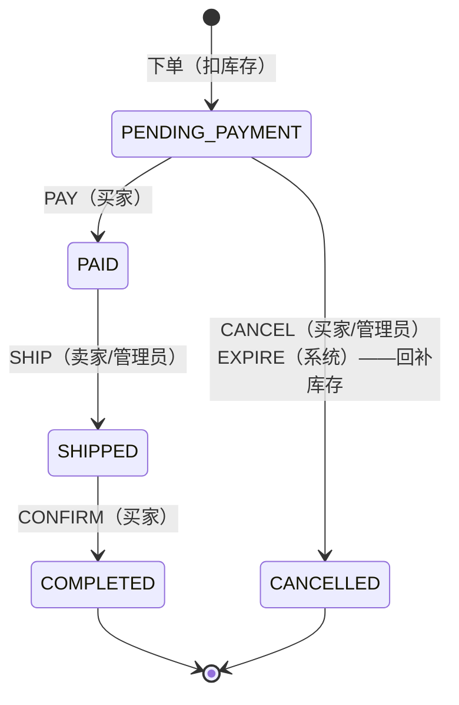

# Prime Deals 设计说明

本文说明重写后的架构，以及订单链路中几个关键问题（超卖、重复下单、状态并发、超时取消）是怎么解决的、为什么这样选。

## 1. 背景：从 dream-fire 到 Prime Deals

旧项目 dream-fire 是 Spring Boot + MyBatis + 静态 Vue 页面，有用户、商品、购物车三张表。重写时保留了它的业务范围，同时修掉了几个结构性问题：

| 旧实现 | 问题 | 新实现 |
| --- | --- | --- |
| 密码明文存储，数据库凭据提交在 `application.yml` | 泄露即全量失守 | bcrypt 哈希；所有凭据走环境变量，生产环境拒绝示例密钥 |
| 登录在前端比对用户列表，接口用 `userId` 参数识别身份 | 任何人都能以任何人身份操作 | JWT + 全局守卫 + 角色（买家/卖家/管理员），身份只取自 token |
| 价格用 `Double` | 浮点舍入误差 | 全程整数“分”（`price_cents`），价格字符串用字符串运算解析 |
| 商品 5 个图片列 `imageUrl1..5` | 结构僵硬 | `images text[]` |
| 上传只校验客户端声明的 MIME | 可伪装上传任意文件 | 按文件魔数识别 JPEG/PNG/WebP，随机文件名，整批校验通过才落盘 |
| 没有审核状态，"审核页"实际上是商品列表 | 卖家上传即上架 | `PENDING → APPROVED/REJECTED`，编辑后重新审核，审核用 CAS 防重复决策 |
| 搜索 `LIKE CONCAT('%', q, '%')` | 用户输入 `%`/`_` 变成通配符 | 转义后 `ILIKE ... ESCAPE` |
| 没有订单 | — | 本次重点，见下文 |

## 2. 总体架构

```
浏览器 ──► nginx (frontend 容器)
             ├─ /            React SPA
             ├─ /api/*   ──► NestJS (backend 容器) ──► PostgreSQL   权威数据：用户、商品、库存、订单
             └─ /uploads/* ─►                      └─► Redis        幂等快路径、token 吊销、登录限流、BullMQ 延时队列
```

- **PostgreSQL 是唯一的事实来源。** 库存、订单状态、幂等唯一性都由数据库约束保证。
- **Redis 只做加速和调度。** Redis 不可用时系统降级而不出错：幂等退回到数据库唯一约束，token 吊销检查放行（token 本身短期有效），登录限流跳过，超时取消由数据库清扫器完成。
- 前后端同源（nginx 反代），生产环境不需要 CORS。
- 模块划分：`auth`、`users`、`products`、`cart`、`orders`、`admin`。订单模块内部再分为 `OrdersService`（业务）、`order-state-machine`（纯函数规则）、`IdempotencyService`、`OrderTimeoutQueue`（生产者）、`OrderTimeoutWorker`（消费者 + 清扫器），生产者与消费者拆开以避免循环依赖。

## 3. 数据模型

```
users(id, username UNIQUE, password_hash, phone, role)
products(id, seller_id→users, name, description, price_cents CHECK>0,
         stock CHECK>=0, category, images text[], status, review_note, reviewed_by, reviewed_at)
cart_items(id, user_id, product_id, quantity CHECK>0, UNIQUE(user_id, product_id))
orders(id uuid, user_id, status, total_cents, idempotency_key, request_hash,
       expires_at, paid_at, shipped_at, completed_at, cancelled_at, cancel_reason,
       UNIQUE(user_id, idempotency_key), INDEX(status, expires_at))
order_items(order_id, product_id, seller_id, product_name, product_image, unit_price_cents, quantity)
order_status_logs(order_id, from_status, to_status, event, actor_id, created_at)
```

- `order_items` 保存下单时的名称、图片、单价**快照**，之后改价或改名不影响历史订单。
- `order_status_logs` 是追加式审计日志，每次状态变化一行，系统触发（超时）时 `actor_id` 为空。
- Schema 只通过迁移变更（`synchronize: false`），应用启动时自动执行待执行的迁移。

## 4. 库存防超卖

**做法：在事务里用条件更新扣减库存。**

```sql
UPDATE products
   SET stock = stock - :qty
 WHERE id = :id AND status = 'APPROVED' AND stock >= :qty
RETURNING *;
```

- 检查和扣减是同一条语句，PostgreSQL 的行锁保证并发请求排队执行，后到的请求看到的是已扣减的库存；`affected = 0` 即库存不足或已下架，事务回滚，返回 409 并附带当前可用量。
- 多商品订单在**同一事务**里逐行扣减，任一行失败全部回滚（e2e 中验证了"一行不足，其他行库存不变"）。
- 扣减前把订单行按 `product_id` 排序，所有事务以相同顺序加锁，**避免死锁**；e2e 用两种相反的商品顺序并发下单验证。
- `CHECK (stock >= 0)` 作为最后一道防线，即使未来有代码绕过条件更新也无法写出负库存。
- 卖家调整库存同样是相对更新 `stock = stock + :delta WHERE stock + :delta >= 0`，而不是"读出来、改、写回"，所以不会覆盖同一时刻被订单扣掉的库存；商品编辑接口刻意不接收 `stock` 字段。

**为什么没有用 Redis 预扣库存（Lua 脚本）？** 预扣能把热点行的压力挡在数据库之外，适合秒杀级流量，但代价是 Redis 与数据库两份库存需要对账和补偿（扣了 Redis 但事务失败、Redis 重启丢数据等）。本项目的流量规模下，单行条件更新足够快且一致性最简单。若将来有秒杀场景，可以在条件更新前加一层 Redis 令牌（只做限流、不做权威库存），数据库仍是最终裁决。

**购物车不占库存。** 加购只是意向；库存在下单时才被占用，下单后进入 15 分钟付款窗口。这样被遗弃的购物车不会锁住库存，代价是加购时看到的库存可能在结算时已不足——前端会在 409 时刷新购物车并标出不可购买的行。

## 5. 下单幂等

客户端每次结算生成一个 `Idempotency-Key`（UUID），**重试时复用同一个 key**。前端的 `useCheckoutKey` 在购物车内容不变时始终返回同一个 key，双击、网络超时后重试都不会产生第二个订单；购物车变化或下单成功后才换新 key。

服务端分两层：

1. **Redis 快路径**：`SET idem:order:{userId}:{key} {状态,请求指纹} NX EX 30`
   - 抢到 → 执行下单；完成后改写为 `{done, orderId}`，保留 24 小时。
   - 已存在且已完成 → 直接返回原订单（HTTP 200 + `Idempotent-Replayed: true`）。
   - 已存在但仍在处理 → 409 `IDEMPOTENCY_IN_PROGRESS`，客户端稍后用同一 key 重试即可拿到结果。
   - 指纹不同 → 422 `IDEMPOTENCY_KEY_REUSED`。
   - 下单失败（如库存不足）→ 删除标记，允许用同一 key 重试。
2. **数据库兜底**：`orders` 上的 `UNIQUE(user_id, idempotency_key)`。事务第一步就插入订单行，重复 key 在扣库存之前就因唯一约束失败；捕获后查出已有订单，指纹一致则当作重放返回。Redis 被清空、重启或宕机时，正确性完全由这一层保证（e2e 中手动删除 Redis 记录后重试，仍返回原订单且库存只扣一次）。

请求指纹是归一化后（合并重复商品、按 id 排序）的订单行的 SHA-256，所以 `[{1,×2}]` 与 `[{1,×1},{1,×1}]` 视为同一请求。key 按用户隔离，不同用户使用相同 key 互不影响。

## 6. 订单状态机



- 转移规则是一张**数据表**（`order-state-machine.ts`），`nextStatus(from, event)` 是纯函数，非法转移抛 `IllegalTransitionError`，映射为 409 `ILLEGAL_TRANSITION`。单元测试穷举了所有 状态 × 事件 组合。
- **谁能触发什么**和**能否转移**分开判断：先校验可见性（看不到的订单一律 404，不泄露存在性）与权限（403），再查转移表（409）。
- 卖家只能发货"全部商品都属于自己"的订单；跨卖家订单由管理员发货。卖家的销售列表只展示自己的订单行。
- 服务端在每个订单响应里返回当前查看者可执行的 `actions`，前端按钮直接由它渲染，不在前端复制一份规则。

**并发转移用比较并交换（CAS）解决：**

```sql
UPDATE orders SET status = :to, paid_at = now()
 WHERE id = :id AND status = :from AND expires_at > now();   -- PAY 额外要求未过期
```

读到的状态作为 `WHERE` 条件，`affected = 1` 才算成功。付款与超时取消、付款与用户取消、重复取消同时到达时，只有一个能匹配到原状态，另一个得到 409。回补库存与状态更新在同一事务内，因此"取消成功"与"库存回补"要么都发生、要么都不发生，不会出现重复回补（e2e 中对付款/取消竞争循环验证了 5 轮）。

## 7. 超时自动取消

付款窗口默认 15 分钟（`ORDER_PAYMENT_TTL_SECONDS`）。`expires_at` 用数据库时钟写入（`now() + interval`），与状态机里的 `now()` 比较保持同一时钟。

两套互相独立的机制，调用同一个幂等的 `OrdersService.expire()`：

1. **BullMQ 延时任务（准时）**：下单事务提交后投递一个延时任务，`jobId = 订单 id`，因此重复投递也只有一个任务。到点后执行 `EXPIRE` 转移。订单被付款或取消时尽力删除任务；即使没删掉，处理器面对非待付款订单也只是空操作。若 Redis 与 Postgres 时钟略有偏差导致"还没到期"，任务抛错并按指数退避重试。
2. **数据库清扫器（兜底）**：每隔 `ORDER_SWEEP_INTERVAL_MS` 查询 `status = PENDING_PAYMENT AND expires_at <= now()` 的订单（有 `(status, expires_at)` 索引），逐个执行同样的取消。覆盖 Redis 数据丢失、投递失败、服务重启等情况。

为什么两者都要：只用定时扫表，取消时间精度受扫描周期限制，且扫描频繁时有无谓的数据库负载；只用延时队列，Redis 丢数据就会有订单永远卡在待付款、库存永远被占。两者叠加，正确性靠数据库与 CAS，准时性靠队列。多实例部署时多个 worker/清扫器同时运行也是安全的，CAS 保证每个订单只被取消一次。

付款接口自身也检查 `expires_at > now()`，所以即使取消任务还没来得及执行，过期订单也付不了款（返回 409 `ORDER_EXPIRED`）。

## 8. 认证与安全

- JWT（默认 2 小时），载荷含 `sub`、`role`、`jti`。注销时把 `jti` 写入 Redis 黑名单，TTL 为 token 剩余有效期。
- 全局守卫：默认所有接口需要登录，`@Public()` 显式放开，`@Roles()` 限制角色。公开接口如果带了有效 token 也会识别身份（用于让卖家查看自己未上架的商品）。
- 管理员不能自助注册，由环境变量在启动时创建。
- 登录失败计数：同一用户名 15 分钟内失败 5 次即锁定（429）；未知用户与错误密码返回相同信息。
- 全局 `ValidationPipe`（白名单 + 拒绝多余字段）；金额、数量、分页等都有上下界；订单总额超过 32 位整数范围时拒绝。

## 9. 测试策略

| 层次 | 内容 | 工具 |
| --- | --- | --- |
| 后端单元 | 状态机全组合、幂等指纹与 Redis 交互（含 Redis 宕机降级）、金额解析、图片魔数 | Jest |
| 后端 e2e | 启动完整应用连接真实 PostgreSQL + Redis：认证与角色、上传与审核、购物车、并发防超卖、并发幂等、Redis 丢失兜底、状态机与权限、付款/取消竞争、超时任务与清扫器 | Jest + Supertest |
| 前端 | 价签、订单进度、倒计时；结算发送幂等 key 且失败重试复用同一 key；库存不足时刷新购物车；订单页按 `actions` 渲染按钮 | Vitest + Testing Library |
| 冒烟 | 在 docker compose 起的完整环境中走一遍下单链路 | `scripts/smoke-test.sh` |

并发相关的结论都由 e2e 在真实数据库上验证，而不是用 mock：mock 无法暴露行锁、唯一约束和事务隔离的真实行为。

## 10. 已知取舍与后续工作

- **支付是模拟的。** `POST /orders/:id/pay` 直接把订单置为已付款。接入真实支付时应改为：创建支付单 → 支付网关异步回调（验签、按网关交易号幂等）→ 触发 `PAY` 转移；状态机与 CAS 逻辑不变。
- **已付款订单不能取消/退款。** 需要新增 `REFUND_REQUESTED`、`REFUNDED` 等状态及对应转移。
- **跨卖家订单不拆单。** 只能由管理员整体发货。更完整的做法是按卖家拆成子订单，各自发货。
- **图片存本地磁盘卷。** 多实例部署应换成对象存储（S3 等）并由 CDN 分发；`ImageStorageService` 是唯一需要替换的地方。
- **商品搜索用 `ILIKE`。** 数据量增大后可以加 `pg_trgm` 索引或接入专门的搜索引擎。
- **没有 refresh token。** 访问令牌过期后需重新登录。
